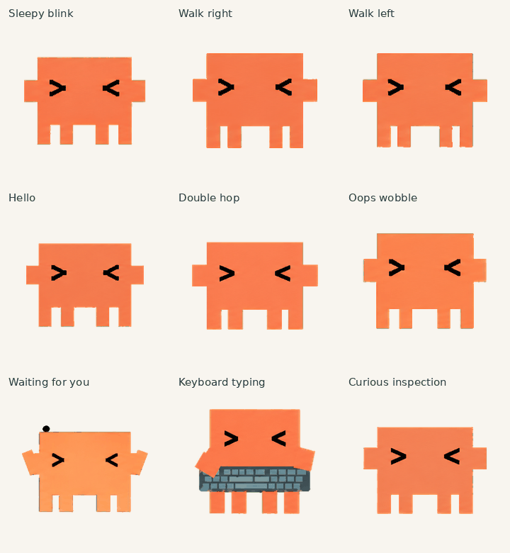

# Dario Pet

珊瑚色方块桌面伙伴：九种动作、十六个视线方向，以及独立思考动图。



## 当前版本

最终图集：[assets/atlas/dario-v2.png](assets/atlas/dario-v2.png)。此版本已完成部署后的像素比对验证。工作状态使用键盘打字，等待状态使用左上角省略号；独立思考 GIF 不参与自动状态切换。

- 透明 PNG，1536×2288，8列×11行；单格192×208。
- 九动作共57帧，另有16个视线帧；15个空格保持透明。
- [原生等待预览](previews/Dario-waiting-left.gif) · [独立思考](standalone/thinking/previews/Dario-thinking-idle-match.gif)

## 目录

| 路径 | 内容 |
|---|---|
| `assets/` | 发布图集、九状态逐帧、16视线 |
| `previews/` | 单动作、全动作、比较图、MP4 |
| `standalone/thinking/` | 单独思考动图与逐帧 |
| `sources/` | 本项目生成源条带、角色参考、打字候选与选帧 |
| `archive/` | 标注接受、否决、已替代的设计里程碑及旧部署回滚图 |
| `docs/` | 中文设计、动作语义、制作及权利说明 |
| `qa/` | 去除私有标识的质量检查结果；不是平台工具源码 |
| `scripts/` | 本项目独立编写的可移植装配、完整性检查、预览脚本 |

## 本地重建（不部署）

```bash
python -m venv .venv
# 激活环境后
pip install -r requirements.txt
python scripts/build.py
python scripts/check.py
python scripts/previews.py
```

重建以已批准的RGBA逐帧为输入，不调用图像生成服务，不重新绘画。像素结果必须与发布图集相同；不同PNG编码器产生的文件字节可能不同。`scripts/check.py`是项目完整性检查，**不替代目标平台的审核或完整验证**。

上传或切换宠物需使用目标应用支持的接口。本仓库不含凭证、账号配置或自动部署脚本，也不修改任何应用的宠物选择。

详见[动作说明](docs/animations.md)、[设计与制作](docs/design.md)、[来源与使用边界](docs/provenance.md)。
